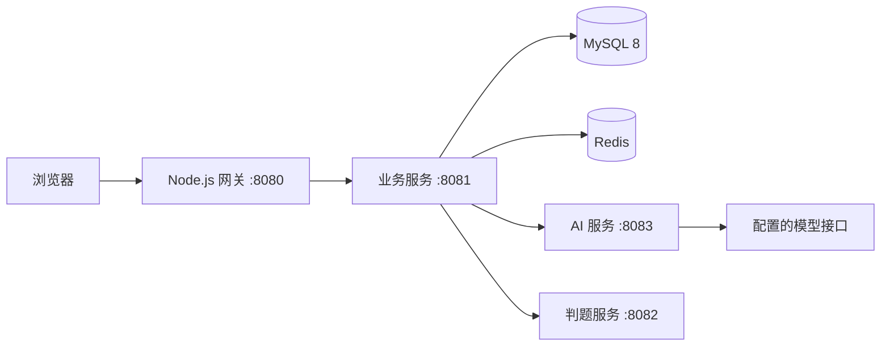

# AI 智能刷题考试平台

基于 **Spring Boot 3、Vue 3 和独立 AI / 判题服务**的在线练习与考试平台。面向管理员和学生，覆盖题库维护、练习、错题复习、考试、自动评分，以及 AI 出题确认与审核流程。

本仓库包含平台源码、初始化 SQL、测试和运行文档。

## 功能

| 角色 / 模块 | 当前实现 |
| --- | --- |
| 学生 | 注册登录、分类题库、在线练习、练习统计、错题掌握标记、收藏和点赞 |
| 考试 | 试卷发布、开始考试、保存答案、交卷、结果与排名 |
| 管理员 | 用户状态与角色、分类、题目维护和审核、考试管理、服务拓扑 |
| AI 出题 | 异步生成、生成日志、结果确认入库；不填 API Key 时使用固定演示题 |
| 自动判题 | 单选、多选、判断、填空，独立 HTTP 判题服务 |

AI 的 `DEMO` 模式用于检查流程；只有配置模型接口与 API Key 后才调用真实模型。生成题目需要确认入库及审核，不能将演示输出当作模型能力评测结果。

## 技术与结构

| 路径 | 技术 / 职责 |
| --- | --- |
| `backend/` | Java 21、Spring Boot 3.3.5、MyBatis-Plus、JWT；业务、鉴权与服务编排 |
| `services/ai-service/` | 无状态 AI 生成服务、响应规范化；兼容 Chat Completions 接口 |
| `services/judge-service/` | 无状态判题服务与题型策略 |
| `gateway/` | Node.js HTTP / WebSocket 代理、生产静态文件服务 |
| `frontend/` | Vue 3、TypeScript、Element Plus、Pinia、Vite 8 |
| `sql/ai_exam.sql` | MySQL 初始化表结构、演示账号、题目和模型配置项 |
| `docs/` | 部署、接口与验证说明 |



## 快速开始

准备 JDK 21、Maven 3.9、Node.js 24 LTS、MySQL 8 和 Redis。Vite 8 要求 Node.js 20.19+ 或 22.12+；推荐使用本项目构建验证所用的 Node.js 24。

```powershell
git clone https://github.com/Muco-1117/ai-exam-platform.git
Set-Location ai-exam-platform
mvn.cmd -B clean verify
npm.cmd --prefix frontend ci
npm.cmd --prefix frontend run build
```

在**独立的本地数据库环境**执行 `sql/ai_exam.sql`；该脚本含 `DROP DATABASE IF EXISTS ai_exam`，会重建同名数据库。已有数据时先备份，不要直接重复导入。示例账号 `admin` / `student` 的初始密码均为 `123456`，仅用于本机演示。

按[运行与部署说明](docs/运行与部署说明.md)设置 `DB_PASSWORD`、`JWT_SECRET` 和所有 Java 服务一致的 `SERVICE_TOKEN`，分别在终端启动三个 Java 服务、网关和前端。开发页面默认访问 **http://localhost:5173**，构建后可由网关在 **http://localhost:8080** 提供页面。

## 文档

- [运行与部署说明](docs/运行与部署说明.md)：数据库、环境变量、逐服务启动、模型配置、故障排查。
- [服务与接口说明](docs/服务与接口说明.md)：路由、鉴权与源码入口。
- [验证记录](docs/验证记录.md)：本次实际执行范围及局限。
- [贡献指南](CONTRIBUTING.md) · [安全说明](SECURITY.md)

## 当前边界

没有提供服务注册中心、Spring Cloud 配置、Docker 编排或集群部署方案。AI 服务按配置的外部模型生成题目，效果取决于模型与提示；当前仓库不声称完成生产部署验收。

未指定本项目的开源许可证；第三方依赖的许可按各自项目处理。公开仓库不自动授予额外的使用、分发或再许可权利。
